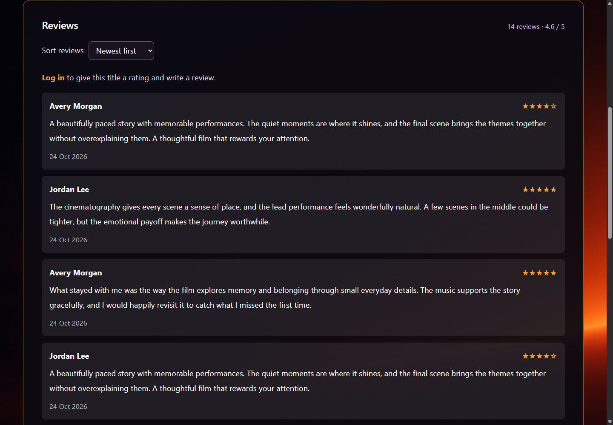
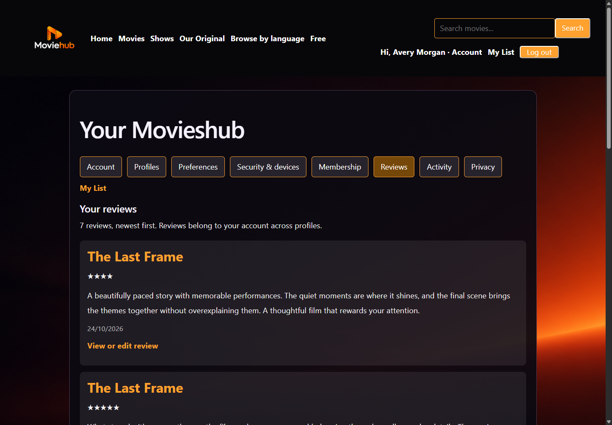

# Movieshub

## Run

Set MongoDB, JWT_SECRET, and TMDB_API_KEY in server/.env (see server/.env.example).
Run `npm start` from this directory to build the React app and serve it with Express.
For development, run `npm --prefix server run dev` and `npm --prefix client run dev` in separate terminals. Vite proxies /api to port 5000.

## Account services

The Account link provides account name/email/password changes, up to five profiles, profile PINs, kids family filtering, preferences, device sessions and revocation, demo membership, browsing activity, JSON data export, and permanent account deletion. My List and like/dislike ratings are separate for each profile. Existing Movieshub accounts initialize their profile automatically. Google sign-in, password recovery, and reviews remain available.

Password changes and password resets invalidate earlier tokens. Profile PINs are hashed, checked on the server, and unlocked per device session. Locked profiles withhold their lists, ratings, and activity until unlocked. Unlock each protected profile before exporting its data. Account deletion also removes the user's reviews.

Membership is a demo setting with no billing integration. Quality, subtitles, autoplay, and notification preferences are stored; no new player or notification delivery service is connected. Language applies to live sections. Kids profiles filter live results by family/animation genres and hide local catalogue entries without matching genre metadata; this is a genre filter.

## Automatic movie listings

Home includes Top Rated, Popular Movies, In Theatres, and Upcoming. The new sections come from TMDB and link to stable movie IDs, including titles absent from the manually curated catalogue. Theatre results use TMDB's India now-playing feed. Upcoming uses India theatrical release dates from tomorrow through the next 180 days.

MongoDB stores catalogue records with the India date, language, family filter, and refresh timestamp. Successful records refresh at most hourly. The running server checks every 15 minutes, refreshes the default sections after midnight, and refreshes other language/profile variants on request. Open browser tabs check for date changes every 30 seconds and refresh hourly or on returning after a sleep. Cached records from earlier dates are never presented as today's listings. Same-day stale records are explicitly marked when the provider is unavailable. Automatic refresh needs the server to be running.

The curated `mlist.jsx` catalogue remains available below the live sections; live records are stored in MongoDB rather than rewriting that source file.

TMDB endpoints: https://developer.themoviedb.org/reference/movie-now-playing-list and https://developer.themoviedb.org/reference/discover-movie

## Validation

`npm --prefix client run lint`
`npm --prefix client run build`
`npm --prefix server test`

To include the MongoDB account integration test on Windows PowerShell:

```powershell
$env:RUN_MONGO_TESTS='1'
npm --prefix server test
```

This integration test uses a randomly named movieshub_test_* database on localhost:27017 and removes only that test database afterward.
## Series and shows

Home groups movie feeds and non-movie feeds separately. The Shows category includes Top Rated Series, Popular Series, and Upcoming Series; the Movies category includes only movie feeds. All series, TV shows, web series, anime, and cartoons remain in the existing Shows catalogue category.

Series feeds use TMDB TV endpoints and the same hourly caching, India date rollover, language preferences, family filtering, and arrow controls as movies. Upcoming Series includes shows whose first premiere date is tomorrow through the next 180 days; it does not list new episodes or seasons of existing shows. These TV lists are global, rather than India theatre feeds.

Series cards link to /movie/<mlist index> when a matching non-movie entry exists, otherwise /title/tv/<TMDB id>.

TV API reference: https://developer.themoviedb.org/reference/discover-tv

All live movie and series sections provide See all pages at /browse/<section>. These request successive TMDB pages in provider order: popularity descending for Popular, rating order for Top Rated, and the same theatre/upcoming filters as the previews. First/Previous/Next/Last and a page jump navigate through results. TMDB's supported limit is 500 pages. Each page is cached separately with provider totals; recent curated catalogue pages still show 30 entries per page.
All catalogue browse views use 30 titles per page. The backend combines successive 20-item TMDB pages while preserving their order and converts provider totals into 30-item page counts (up to 334 display pages). Final pages or pages with excluded family/date-filtered entries can contain fewer titles.
Review identities for curated TV entries use their catalogue title/year and TMDB season numbers, independent of TMDB series IDs and array position. Shared TMDB IDs continue to fetch metadata only. Existing TV reviews were reassigned using their saved exact catalogue titles, preserving the former ID in legacyMovieId; unmatched reviews remain unchanged. Generic TMDB pages with multiple catalogue matches no longer silently select the first season entry.

See [API and database design](docs/architecture.md), [deployment](docs/deployment.md), [security audit](docs/security.md), and [demo walkthrough](docs/demo.md).

## Review and discovery improvements

Reviews support existing ratings/edit/delete plus sorting, pagination, whole-title average/count, report intake and private account review history. Browser sessions use HTTP-only cookies; metadata credentials remain on the server. Existing browser users must sign in again after this upgrade. See [security notes](docs/security.md).




[Mobile screenshot](docs/screenshots/reviews-mobile.png) · [Short demo](docs/demo.webm) · [Architecture diagram and API](docs/architecture.md) · [Validation results](docs/validation.md) · [Measured build footprint](docs/performance.md)

The screenshots/demo use disposable test accounts and synthetic movie metadata. Run `npm run build` and `npm run demo` to regenerate them with Chrome and local MongoDB. The recording is a short slideshow of real browser captures; an interview narration outline is in [the demo walkthrough](docs/demo.md).

## Production and distribution

Dockerfile, local Compose, Render blueprint and GitHub Actions checks are included. Connect the intended GitHub, Render and Atlas projects before publishing. This project copy has no Git history, and formerly embedded provider credentials still need owner-side rotation. Local checks do not constitute live deployment verification.

`npm run package` writes `artifacts/movieshub-source.zip`, excluding `.env` secrets, `node_modules`, generated builds, logs and `.git`. Keep the development `.env` private and use the `.env.example` templates when configuring a fresh checkout.
