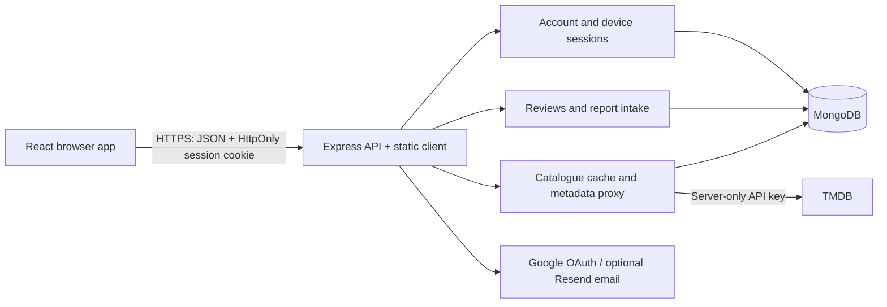

# Architecture and API

The client and API share one production origin. Vite proxies `/api` during development. `server/app.js` builds the application without starting a database or listener; `server/index.js` validates configuration, connects MongoDB, starts refresh jobs and handles shutdown. Account/session, review, security and metadata concerns live in separate modules.

## Collections

| Collection/model | Stored data and access |
| --- | --- |
| User | Unique normalized email, password hash, optional Google identity, reset version and account preferences/profiles. Optimistic concurrency rejects conflicting account writes instead of silently overwriting them. |
| AccountSession | SHA-256 token digest, user ID, device label, expiry, revocation and unlocked profile IDs. TTL expiry removes old sessions. Each authenticated request checks the database record and password version. |
| Review | Movie identity, display title, author reference, integer rating 1–5, text 150–1,500 characters, timestamps. Indexed by title/date, author/date and title/rating/date. Multiple reviews per account remain supported for compatibility. |
| ReviewReport | Review and reporting user references, reason and pending/dismissed/resolved status. Unique review/user index makes reporting idempotent. There is no public moderation/admin endpoint. |
| CatalogueRecord | Language/profile-filter/day/page-scoped provider results, timestamps and totals. Display pages contain up to 30 entries; provider pages contain 20. |

Review ratings summarize reviews, not distinct reviewers. Sorting is deterministic using `_id` as a final tie-breaker. Existing title identities, including curated TV season identities, are preserved. Account review history is private and shared across that account's profiles.

## Routes

All mutation bodies must be JSON objects. Errors use `{ "message": "..." }`; unexpected errors include a request ID. Authentication errors return 401, access/locked-profile errors 403, missing or other-user resources 404, validation errors 400, duplicates/conflicting writes 409 and throttling 429 with `Retry-After`.

| Route | Behavior |
| --- | --- |
| `GET /api/health` | 200 with connected database; otherwise 503. No connection details. |
| `POST /api/auth/register`, `/login` | Validate credentials; issue HttpOnly SameSite=Lax session cookie; return public user data. |
| `GET /api/auth/me` | Current user, authenticated. |
| `POST /api/auth/logout` | Revoke current database session and clear cookie. |
| `GET /api/auth/google`, `/google/callback` | OAuth flow with random state nonce and protected intermediate cookie. |
| `POST /api/auth/google/session` | Exchange intermediate OAuth cookie for normal device session. |
| `POST /api/auth/forgot-password`, `/reset-password` | Reset flow; version changes invalidate existing sessions. Development may return a reset URL; production does not. |
| `GET/PATCH/DELETE /api/account` | Read/update/delete own account. Sensitive changes require current password. |
| `GET /api/account/export` | Own account and reviews; locked profile data withheld. |
| `PATCH /api/account/preferences`, `/membership` | Validated stored preferences/demo membership. |
| `GET/DELETE /api/account/sessions` | List/revoke own other devices. |
| `POST /api/account/profiles` | Create up to five profiles. |
| `PATCH/DELETE /api/account/profiles/:id` | Update/delete own profiles; PIN-protected profiles must be unlocked, except PIN reset with account password. |
| `POST /api/account/profiles/:id/unlock` | Rate-limited PIN unlock, scoped to current device. |
| `POST /api/account/profiles/:id/watchlist` | Toggle validated title in own unlocked profile, capped at 500. |
| `POST/DELETE /api/account/profiles/:id/history` | Record/clear own unlocked profile browsing activity, capped at 100. |
| `POST /api/account/profiles/:id/ratings` | Set/clear profile like/dislike. |
| `GET /api/movies/:movieId/reviews` | Public, paginated reviews and whole-title summary. |
| `POST /api/movies/:movieId/reviews` | Authenticated, validated creation. |
| `PUT/DELETE /api/movies/:movieId/reviews/:reviewId` | Author-only edit/delete; both movie identity and author are checked in the database query. |
| `POST /api/movies/:movieId/reviews/:reviewId/report` | Authenticated report intake; cannot report own review. |
| `GET /api/account/reviews` | Paginated private review history. |
| `GET /api/catalogue/:kind?page=1&profile=...` | Public default or authenticated account/profile filtering. |
| `GET /api/tmdb/*` | Allowlisted metadata paths and query fields. Server injects provider key. Not a general URL proxy. |

Review query parameters: `page` 1–10,000, `limit` 1–50 (default 10), `sort` `newest`, `oldest`, `highest` or `lowest`. Response: `reviews`, `page`, `pageSize`, `total`, `totalPages`; title lists also return `averageRating` (null for no reviews) and `sort`.

Example: `/api/movies/movie%3A42/reviews?page=2&limit=10&sort=highest`.

## Limits and operations

Per-process limits: 600 API requests/minute/IP, 30 auth mutations/15 minutes/IP, 30 review mutations/15 minutes/user, 300 metadata reads/minute/IP; existing account password/PIN checks have a separate 30-attempt/15-minute limit. For multiple instances, replace these in-memory limits and metadata cache with shared storage before scaling. Set proxy trust only to the actual trusted hop count.

No performance speedup is claimed. Pagination bounds response sizes and indexes support common queries, but no before/after production dataset benchmark has been run. Use `explain('executionStats')` on representative data and record documents examined, latency distribution and response size before making performance claims.
